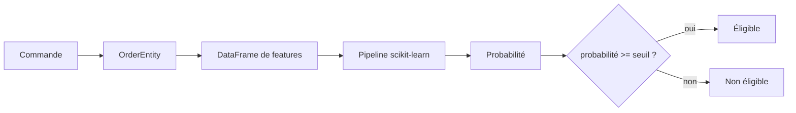
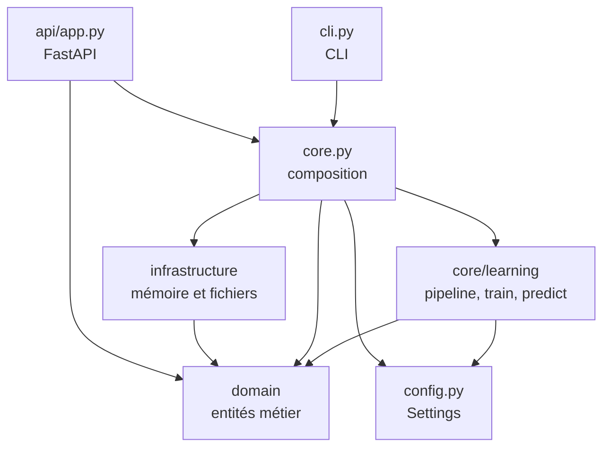
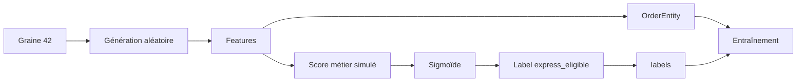
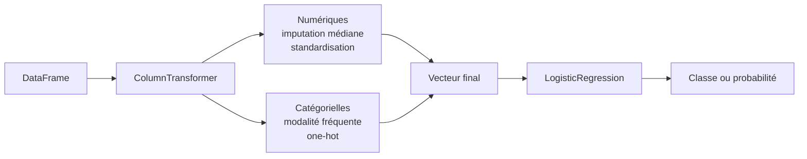
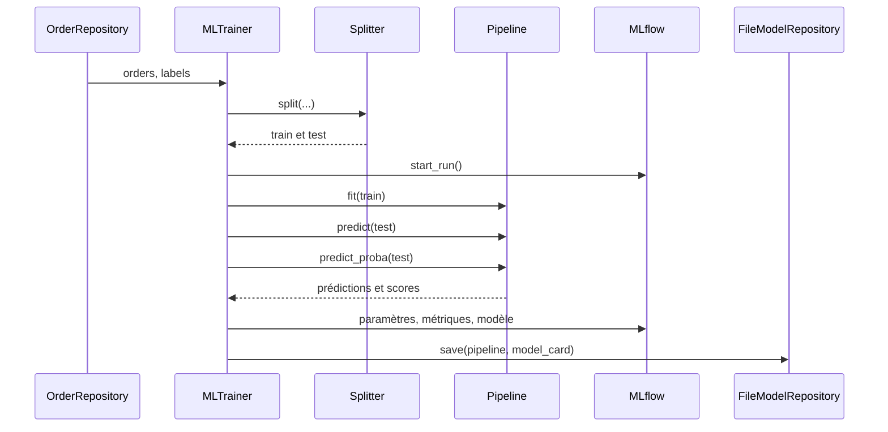
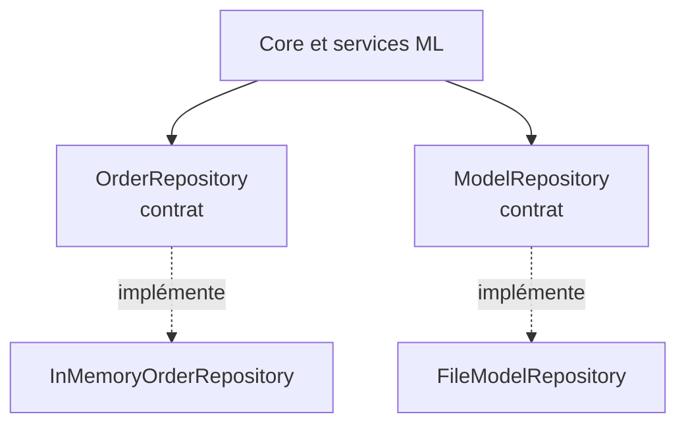
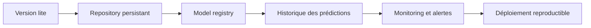

# Architecture logicielle de `livraison_express_lite`

> **Objectif**
>
> Comprendre comment ce projet transforme un prototype de Machine Learning en petite application exploitable : organisation du code, circulation des données, entraînement, chargement du modèle, API HTTP, configuration, tests et principes de conception.

---

## 1. Résumé en une minute

`livraison_express_lite` prédit si une commande peut bénéficier d'une livraison express. Une commande est décrite par des variables numériques et catégorielles : distance, poids, météo, zone de livraison, capacité du transporteur, etc.

| Usage | Entrée | Résultat | Point d'entrée |
|---|---|---|---|
| Entraînement | commandes synthétiques + labels | pipeline, métriques et artefacts | `python -m livraison_express train` |
| Prédiction | une commande JSON | probabilité, décision oui/non, version et horodatage | API `POST /predict` ou CLI |

Le principe essentiel est la séparation entre **entraîner** et **servir** : l'API ne réentraîne pas le modèle lorsqu'elle démarre ; elle charge un modèle produit par un job d'entraînement.



---

## 2. Périmètre et coexistence de deux packages

Le dépôt contient un répertoire Python :

```text
src/
└── livraison_express_lite/   # version corrigée minimale du projet
```

Ce document décrit  `src/livraison_express_lite/`.

---

## 3. Arborescence

```text
src/livraison_express_lite/
├── __init__.py
├── __main__.py                  # point d'entrée python -m
├── cli.py                       # serve, train, predict
├── config.py                    # configuration par environnement
├── domain/
│   ├── entities.py              # commande, prédiction, model card
│   └── exceptions.py
├── core/
│   ├── core.py                  # racine de composition
│   └── learning/
│       ├── ml_pipeline.py       # prétraitement + classifieur
│       ├── ml_predict.py        # prédiction
│       ├── ml_trainer.py        # entraînement et métriques
│       ├── order_feature.py     # contrat des features
│       └── train_test_splitter.py
├── infrastructure/
│   ├── order_repository.py      # interface de stockage des commandes
│   ├── model_repository.py      # interface de stockage du modèle
│   └── implementation/dev/
│       ├── order_generator.py
│       ├── in_memory_order_repository.py
│       └── in_memory_model_repository.py
└── api/
    └── app.py                   # FastAPI et endpoints
```

| Couche | Question | Exemples |
|---|---|---|
| `domain` | Qu'est-ce qu'une commande ou prédiction ? | `OrderEntity`, `PredictionEntity` |
| `core/learning` | Comment transformer les données et utiliser le modèle ? | `MLPipeline`, `MLPredict` |
| `infrastructure` | Où sont les données et l'artefact ? | mémoire, fichier Joblib |
| `api` | Comment exposer le service HTTP ? | FastAPI, `/predict` |
| `cli` | Comment lancer un job ou une prédiction ? | `serve`, `train`, `predict` |
| `config` | Comment changer le comportement sans modifier le code ? | `.env`, variables |

---

## 4. Architecture en couches



Une couche de haut niveau ne devrait pas connaître plus que nécessaire les détails techniques d'une couche de bas niveau. Dans une architecture idéale, `domain` resterait indépendant de FastAPI, pandas, Joblib et MLflow. Dans cette version lite, la séparation est **partielle** : elle sert d'exemple minimal et de support de discussion.

---

## 5. Les objets métier

### `OrderEntity`

`domain/entities.py` définit une commande sous forme de `dataclass(frozen=True)`.

| Catégorie | Champs |
|---|---|
| Temps | `hour`, `day_of_week`, `weekend` |
| Quantitatif | `distance_km`, `order_value_eur`, `weight_kg`, `preparation_time_min`, `carrier_capacity` |
| Disponibilité | `stock_available` |
| Catégoriel | `weather`, `delivery_zone`, `customer_type` |
| Identification | `order_id` facultatif à la création |

`order_id` identifie une commande mais ne doit pas influencer le modèle : il n'est donc pas une feature.

### `PredictionEntity`

Une prédiction contient :

```text
express_eligible       bool       valeur machine
decision               str        "oui" ou "non"
probability            float      score entre 0 et 1
model_version          str        modèle utilisé
prediction_timestamp   str        date ISO avec fuseau
```

La probabilité et la décision sont différentes : `0.51` et `0.99` peuvent toutes deux donner « oui » avec un seuil de `0.5`, mais ne représentent pas le même niveau de confiance.

### `ModelEntity`

Cette *model card* rassemble les métadonnées utiles pour expliquer un artefact : type du modèle, tâche, cible, features, seuil, métriques, version et date d'entraînement. Elle accompagne le fichier `.joblib`.

---

## 6. Données synthétiques

`order_generator.py` génère des commandes sans base de données externe. Une graine aléatoire (`42` par défaut) rend le résultat reproductible.



Le générateur prend en compte distance, préparation, poids, zone, météo, stock, capacité, client premium, week-end et heure. Ce n'est pas une vérité métier réelle : c'est une **source de données pédagogique**.

- `generate_labeled_orders()` retourne `(orders, labels)` pour l'entraînement ;
- `generate_orders_dataset()` retourne seulement les commandes.

La cible ne doit pas devenir une feature : sinon le modèle reçoit directement la réponse qu'il doit prédire.

---

## 7. Contrat des features

`order_feature.py` centralise `FEATURE_COLUMNS`, `NUMERIC_FEATURES`, `CATEGORICAL_FEATURES` et `orders_to_dataframe()`.

```python
FEATURE_COLUMNS = [
    "hour", "day_of_week", "weekend", "distance_km",
    "order_value_eur", "weight_kg", "stock_available",
    "preparation_time_min", "carrier_capacity", "weather",
    "delivery_zone", "customer_type",
]
```

La conversion est faite à la frontière de l'apprentissage :

```text
OrderEntity
  └─ attributs de FEATURE_COLUMNS
       └─ DataFrame avec le même ordre de colonnes
            └─ Pipeline scikit-learn
```

> **Piège fréquent :** renommer `distance_km` dans un seul endroit crée une divergence entre API, entraînement et prédiction. Les features sont un contrat.

---

## 8. Pipeline Machine Learning

`MLPipeline.get_model_pipeline()` construit deux étapes principales :



### Variables numériques

Les valeurs manquantes sont remplacées par la médiane, puis les colonnes sont standardisées. Cela permet de traiter ensemble kilomètres, euros, minutes, poids, etc.

### Variables catégorielles

Les valeurs manquantes sont remplacées par la modalité la plus fréquente, puis `OneHotEncoder(handle_unknown="ignore")` produit des colonnes binaires. Une catégorie inconnue en production ne fait donc pas nécessairement planter la prédiction.

### Classifieur

Le classifieur est une `LogisticRegression` :

- `max_iter=1000` laisse davantage d'itérations pour converger ;
- `class_weight="balanced"` compense un déséquilibre possible des classes ;
- `random_state` vient de la configuration.

Une pipeline unique garantit que les mêmes transformations sont appliquées à l'entraînement et à la prédiction.

---

## 9. Entraînement, évaluation et artefacts

`TrainTestSplitter` vérifie que le nombre de commandes correspond au nombre de labels, construit le DataFrame, puis réalise un split 80/20 stratifié.

`MLTrainer.train()` suit ce scénario :



| Métrique | Question |
|---|---|
| Accuracy | Quelle proportion totale est correcte ? |
| Precision | Parmi les « oui », combien sont réellement positifs ? |
| Recall | Parmi les positifs réels, combien sont retrouvés ? |
| F1 | Quel compromis entre precision et recall ? |
| ROC AUC | Le classement des positifs devant les négatifs est-il bon ? |

Les artefacts sont :

```text
MODEL_PATH/express_delivery_model.joblib   # pipeline entraînée
MODEL_PATH/metrics.json                     # métriques
MODEL_PATH/features.json                    # colonnes et ordre
```

Dans la version lite, `MODEL_PATH` vaut par défaut `notebooks/artifacts/express_delivery_model.joblib`.

---

## 10. Prédiction

`MLPredict.predict()` :

1. convertit une `OrderEntity` en DataFrame d'une ligne ;
2. appelle `predict_proba()` ;
3. récupère la probabilité de la classe positive ;
4. compare au `model_threshold` ;
5. construit une `PredictionEntity`.

```python
probability = float(model.predict_proba(input_df)[0, 1])
eligible = probability >= threshold
decision = "oui" if eligible else "non"
```

Le seuil n'est pas le modèle. Le modèle produit un score ; le seuil traduit ce score en décision opérationnelle. On peut donc ajuster le seuil sans réentraîner immédiatement.

---

## 11. Repositories et inversion de dépendance

Les classes `OrderRepository` et `ModelRepository` décrivent les opérations nécessaires au reste de l'application.

| Abstraction | Implémentation lite | Limite |
|---|---|---|
| `OrderRepository` | dictionnaire en mémoire | données perdues au redémarrage et non partagées |
| `ModelRepository` | fichier local via Joblib | pas de registre complet ni de rollback |



L'objectif est de pouvoir remplacer le dictionnaire par PostgreSQL ou SQLite sans réécrire `MLPredict`. La version lite garde toutefois le choix des classes concrètes dans `Core`.

---

## 12. `Core`, racine de composition

`core.py` assemble settings, repositories, pipeline, trainer et predictor.

```text
Core(load_model=False)
  ├─ repository des commandes en mémoire
  ├─ pipeline non entraînée
  ├─ MLTrainer
  └─ MLPredict

Core(load_model=True)
  ├─ repository des commandes en mémoire
  ├─ charge le .joblib
  └─ MLPredict, ou service indisponible
```

Le chargement au démarrage évite de relire le fichier à chaque requête. Le code utilise aussi un singleton. C'est simple mais un état global peut compliquer les tests : configuration qui fuit, ordre d'exécution et parallélisme. Une évolution possible est une factory qui construit explicitement un contexte par application.

---

## 13. API FastAPI

`api/app.py` crée l'application et tente de charger le modèle une fois.

| Endpoint | Méthode | Fonction | Cas d'erreur |
|---|---:|---|---|
| `/health` | GET | processus vivant | normalement 200 |
| `/health/ready` | GET | modèle disponible | 503 si absent |
| `/predict` | POST | prédire une commande | 503 si modèle absent |

Exemple de requête :

```json
{
  "hour": 14,
  "day_of_week": 2,
  "weekend": 0,
  "distance_km": 4.5,
  "order_value_eur": 80.0,
  "weight_kg": 2.0,
  "stock_available": 1,
  "preparation_time_min": 20.0,
  "carrier_capacity": 0.8,
  "weather": "normal",
  "delivery_zone": "centre",
  "customer_type": "premium"
}
```

Exemple de réponse :

```json
{
  "express_eligible": true,
  "decision": "oui",
  "probability": 0.8734,
  "model_version": "1.0.0",
  "prediction_timestamp": "2026-10-22T15:30:00+00:00"
}
```

### Liveness et readiness

`/health` indique que le processus HTTP vit. Il ne garantit pas que le service peut prédire. `/health/ready` retourne `503` tant que le modèle n'est pas chargé. Cette distinction est essentielle pour un orchestrateur comme Kubernetes.

---

## 14. CLI et scénarios

```bash
python -m livraison_express train
python -m livraison_express serve
python -m livraison_express predict --file order.json
```

### Entraînement

```text
CLI → Core() → get_training_data()
    → MLTrainer.train()
    → MLflow + FileModelRepository.save()
```

### Serveur

```text
CLI → uvicorn → create_app()
    → Core(load_model=True)
    → modèle chargé une fois
    → requêtes HTTP
```

### Prédiction locale

```text
CLI → lecture JSON → OrderEntity
    → Core(load_model=True) → MLPredict.predict()
    → JSON sur stdout
```

L'entraînement est une commande CLI plutôt qu'un endpoint public : il consomme des ressources et doit être déclenché par un job contrôlé.

---

## 15. Configuration

`config.py` utilise `pydantic-settings`. Les valeurs viennent des variables d'environnement ou de `.env`, avec des valeurs par défaut.

```dotenv
ENVIRONMENT=local
MODEL_PATH=notebooks/artifacts/express_delivery_model.joblib
MODEL_THRESHOLD=0.5
MODEL_VERSION=1.0.0
LOG_LEVEL=INFO
```

La configuration varie selon l'environnement sans modifier le code métier. Le fichier `.env` ne doit pas contenir de secret versionné ; `.env.example` documente le contrat.

---

## 16. Tests et qualité

Les tests de la version complète du dépôt montrent les niveaux de vérification utiles pour une architecture ML :

| Niveau | Vérification | Doublure possible |
|---|---|---|
| Unitaire | fonction ou classe isolée | faux modèle |
| Contrat | toutes les implémentations respectent une interface | repository mémoire |
| Cas d'usage | orchestration entre composants | prédicteur enregistreur |
| API | schémas, statuts et erreurs | client FastAPI |
| Intégration | fichiers, MLflow, datastore | artefact temporaire |

Ne testons pas toujours un vrai modèle pour tester une orchestration : un faux modèle vérifie rapidement les appels, les colonnes et les paramètres sans entraînement coûteux.

```bash
pytest
ruff check .
```

---

## 17. Clean Code, SOLID, KISS, YAGNI et DRY

### Clean Code

- noms explicites : `MLPredict`, `TrainTestSplitter`, `ModelRepository` ;
- fonctions orientées vers une action identifiable ;
- docstrings qui expliquent les décisions et les limites ;
- seuil et graine configurables ;
- erreurs non masquées silencieusement.

Amélioration possible : homogénéiser les noms et supprimer les imports historiques `src...` dans le package installé.

### SOLID

| Principe | Illustration |
|---|---|
| **S — Single Responsibility** | le splitter sépare ; le trainer entraîne ; le predictor prédit ; le repository stocke |
| **O — Open/Closed** | ajouter un repository SQL ne devrait pas modifier le trainer |
| **L — Liskov Substitution** | toute implémentation respecte le contrat du repository |
| **I — Interface Segregation** | les abstractions exposent les opérations nécessaires |
| **D — Dependency Inversion** | `Core` centralise les choix et les services utilisent des contrats |

L'application est pragmatique mais pas parfaite : `Core` connaît directement les implémentations et le singleton ajoute un état global. Ce sont de bons axes de discussion.

### KISS — Keep It Simple

Un dictionnaire mémoire et un fichier local suffisent pour démontrer la chaîne complète. Kafka, Kubernetes et une base distribuée seraient prématurés pour ce périmètre.

### YAGNI — You Ain't Gonna Need It

La version lite ne fournit pas encore historique complet des prédictions, base transactionnelle ou registre de modèles de production. On ajoute une capacité quand un besoin concret la justifie.

### DRY — Don't Repeat Yourself

Les colonnes sont définies une fois dans `order_feature.py`. La conversion commande → DataFrame est réutilisée. Le générateur sépare sortie labellisée et non labellisée sans dupliquer sa logique.

---

## 18. Limites et trajectoire de production

La version lite est pédagogique. Ses limites sont :

1. les commandes en mémoire sont perdues au redémarrage ;
2. le singleton complique configuration et tests parallèles ;
3. le modèle est local, sans rollback ;
4. le contrat HTTP est minimal ;
5. authentification, autorisation et rate limiting ne sont pas traités ;
6. supervision et dérive des données restent à construire ;
7. la version du modèle est une métadonnée, pas encore une vraie résolution de versions.



Chaque étape doit être motivée par un besoin, testée par un contrat et documentée par une décision d'architecture.

---

## 19. Questions de révision

1. Pourquoi `order_id` ne doit-il pas être envoyé au modèle ?
2. Que se passe-t-il si l'API démarre sans fichier `.joblib` ?
3. Pourquoi charger le modèle au démarrage ?
4. Quel risque de modifier `FEATURE_COLUMNS` dans un seul fichier ?
5. Quelle différence entre probabilité et décision ?
6. Pourquoi l'entraînement est-il une commande CLI ?
7. Que changer pour remplacer le dictionnaire par PostgreSQL ?
8. Quels problèmes le singleton peut-il créer en test ?
9. Quels éléments relèvent de YAGNI plutôt que d'un oubli ?

---

## 20. Synthèse

```text
configuration
  → données synthétiques
  → OrderEntity
  → features pandas
  → prétraitement
  → régression logistique
  → métriques MLflow
  → artefact Joblib
  → chargement au démarrage
  → FastAPI /predict
  → PredictionEntity
```

La valeur pédagogique ne vient pas seulement du modèle. Elle vient de la chaîne complète : contrats de données, configuration, stockage, CLI, API et tests. C'est cette chaîne qui transforme une cellule de notebook en logiciel exploitable.


